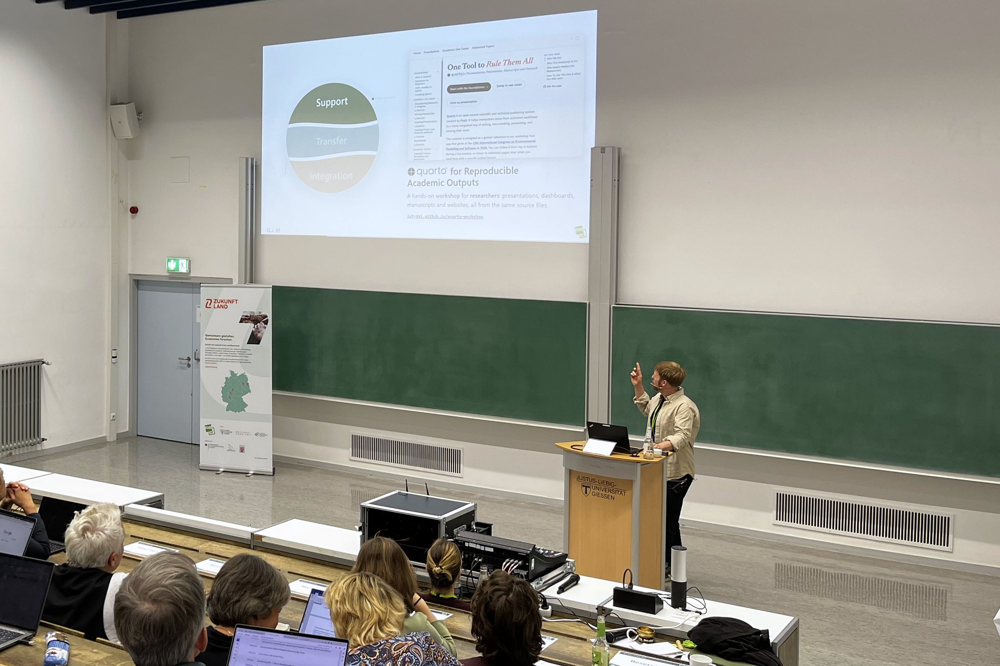

Am 24. September haben wir die Nachmittagssession des IAT-Statusseminars 2026 an der Justus-Liebig-Universität Gießen mit einem Überblick über die Services der Arbeitsgruppe „Daten- und Modellierungsinfrastruktur für Living Labs“ (DML) eröffnet. Ein halbes Jahr nachdem wir unser Servicekonzept beim IAT-Kickoff erstmals vorgestellt hatten, konnten wir nun zeigen, wie dieses Konzept in der Praxis aussieht.

{fig-alt="Ben Black hält am Rednerpult in einem Hörsaal einen Vortrag und zeigt auf eine projizierte Folie mit den DML-Schichten Support, Transfer und Integration; im Vordergrund das Publikum."}

Der Vortrag folgte den drei Schichten unseres Servicekonzepts, jeweils veranschaulicht durch Projekte, die wir gemeinsam mit Kolleginnen und Kollegen im IAT abgeschlossen haben oder derzeit umsetzen:

- **Support**: Unterstützung von Forschenden beim Umgang mit ihren Daten und ihrer Software in allen Phasen eines Projekts. Beispiele waren das IAT-Handbuch zu Datenmanagement und Datenschutz, Forschungssoftware wie [BirdNET-Passage](../projects/birdnet-passage.qmd), die [Karten für die Living-Lab-Workshops](../projects/living-labs-base-maps.qmd), unser [Quarto-Workshop](../projects/quarto-workshop.qmd) und die [IAT-ZALF-Vorlagen](../projects/zalf-iat-templates.qmd).
- **Transfer**: den Kreis zwischen Wissenschaft und Praxis schließen, mit [Projektwebsites](../projects/monkshilllabs.qmd) und dem [Living Lab Explorer](../projects/living-lab-dashboards.qmd), einem gemeinsam mit den IAT-Regionalnetzwerkmanagerinnen und -managern entwickelten Dashboard.
- **Integration**: Forschungsdaten und Methoden im gesamten IAT miteinander verbinden, durch den IAT-Projekttracker, eine gemeinsame Vorlage für Datenmanagementpläne und den [Leitfaden für Policy Labs](../projects/policy-lab-guide.qmd).

Während des Vortrags haben wir dem Publikum außerdem mehrere Live-Fragen gestellt – von der Frage, was mit Forschungsdaten nach Projektende passiert, bis zu den Schulungsformaten, die am besten funktionieren. Vielen Dank an alle, die mitgemacht haben: Ihre Antworten helfen uns, unser Schulungs- und Unterstützungsangebot für das kommende Jahr zu gestalten.

## Die Folien

Unten finden Sie den vollständigen Foliensatz (auf Englisch). Klicken Sie auf die Folien und blättern Sie dann mit den Pfeiltasten oder der Leertaste, oder wechseln Sie in den Vollbildmodus. Die Live-Publikumsfragen sind in dieser Version nicht mehr enthalten.

```{=html}
<div class="deck-embed">
  <iframe id="statusseminar-deck"
          src="/talks/iat-statusseminar-2026/index.html"
          title="Folien: Data and Modelling Infrastructure for Living Labs, IAT-Statusseminar 2026"
          allow="fullscreen" allowfullscreen loading="lazy"></iframe>
</div>
<div class="deck-embed-actions">
  <button type="button" class="btn-brand" data-fullscreen-target="statusseminar-deck">Vollbild</button>
  <a class="btn-ghost" href="/talks/iat-statusseminar-2026/index.html" target="_blank" rel="noopener">In neuem Tab öffnen</a>
</div>
<script>
  /* Full screen the deck's iframe. Where a browser cannot (iPhone Safari
     only allows it for video), open the deck in its own tab instead. */
  document.querySelectorAll("[data-fullscreen-target]").forEach(function (button) {
    button.addEventListener("click", function () {
      var frame = document.getElementById(button.dataset.fullscreenTarget);
      var request = frame.requestFullscreen || frame.webkitRequestFullscreen;
      var openInTab = function () { window.open(frame.src, "_blank", "noopener"); };
      if (!request) { openInTab(); return; }
      Promise.resolve(request.call(frame))
        .then(function () { frame.contentWindow.focus(); })
        .catch(openInTab);
    });
  });
</script>
```

Wenn Sie besprechen möchten, wie wir Ihr Projekt unterstützen können, [nehmen Sie Kontakt mit uns auf](../contact-form.qmd).
