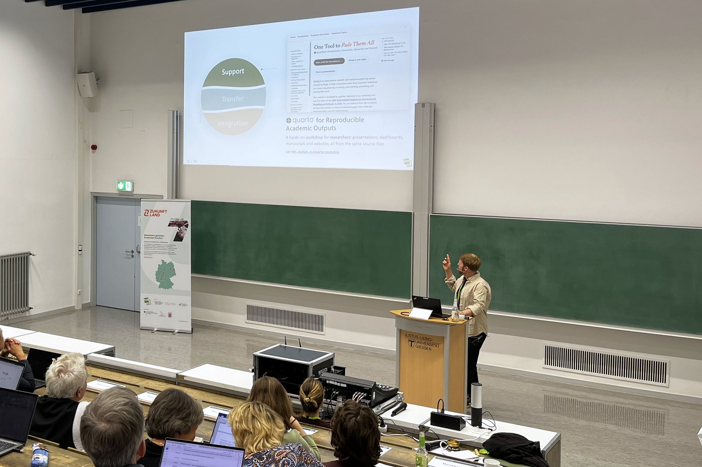

On 24 September we opened the afternoon session of the IAT Statusseminar 2026, held at Justus Liebig University Giessen, with an overview of the services offered by the Data and Modelling Infrastructure for Living Labs (DML) working group. Six months after we first introduced our service concept at the [IAT kickoff](2026-01-iat-kickoff.qmd), this was a chance to show what that concept looks like in practice.

{fig-alt="Ben Black presenting at a lectern in a lecture hall, pointing up at a projected slide showing the DML Support, Transfer and Integration strata, with the audience in the foreground."}

The talk was structured around the three strata of our service concept, each illustrated with projects we have completed or are working on with colleagues across the IAT:

- **Support**: helping researchers manage their data and software across every stage of a project. Examples included the IAT Data Management and Protection handbook, research software such as [BirdNET-Passage](../projects/birdnet-passage.qmd), the [Living Lab workshop maps](../projects/living-labs-base-maps.qmd), our [Quarto workshop](../projects/quarto-workshop.qmd) and the [IAT ZALF templates](../projects/zalf-iat-templates.qmd).
- **Transfer**: closing the loop between science and practice, with [project websites](../projects/monkshilllabs.qmd) and the [Living Lab Explorer](../projects/living-lab-dashboards.qmd), a dashboard co-designed with the IAT Regional Network Managers.
- **Integration**: connecting research data and methods across the IAT, through the IAT Project Tracker, a common data management plan template and the [how-to guide for Policy Labs](../projects/policy-lab-guide.qmd).

During the talk we also asked the audience a series of live questions, from what happens to research data once a project ends to which training formats work best. Thank you to everyone who took part: your answers will help us shape our training and support offer for the coming year.

## The slides

The full slide deck is embedded below. Click on the slides, then use the arrow keys or the space bar to move through them, or switch to full screen. The live audience questions have been removed from this version.

```{=html}
<div class="deck-embed">
  <iframe id="statusseminar-deck"
          src="/talks/iat-statusseminar-2026/index.html"
          title="Slides: Data and Modelling Infrastructure for Living Labs, IAT Statusseminar 2026"
          allow="fullscreen" allowfullscreen loading="lazy"></iframe>
</div>
<div class="deck-embed-actions">
  <button type="button" class="btn-brand" data-fullscreen-target="statusseminar-deck">Full screen</button>
  <a class="btn-ghost" href="/talks/iat-statusseminar-2026/index.html" target="_blank" rel="noopener">Open in a new tab</a>
</div>
<script>
  /* Full screen the deck's iframe. Where a browser cannot (iPhone Safari
     only allows it for video), open the deck in its own tab instead. */
  document.querySelectorAll("[data-fullscreen-target]").forEach(function (button) {
    button.addEventListener("click", function () {
      var frame = document.getElementById(button.dataset.fullscreenTarget);
      var request = frame.requestFullscreen || frame.webkitRequestFullscreen;
      var openInTab = function () { window.open(frame.src, "_blank", "noopener"); };
      if (!request) { openInTab(); return; }
      Promise.resolve(request.call(frame))
        .then(function () { frame.contentWindow.focus(); })
        .catch(openInTab);
    });
  });
</script>
```

If you would like to discuss how we could support your project, [get in touch](../contact-form.qmd).
