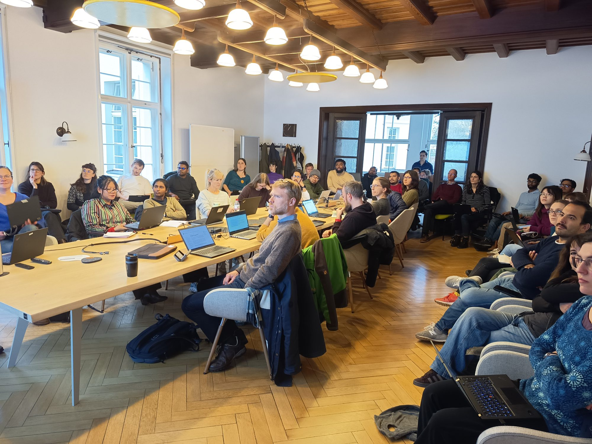

On 19 November we ran our workshop "One Tool to Rule Them All" at the [ZALF Science Conference 2026](https://science-conference.zalf.de/) in Müncheberg. The workshop introduces [Quarto](https://quarto.org/), an open-source publishing system that turns plain-text files with code into manuscripts, slides, websites and dashboards. We first gave it in July at the [iEMSs 2026 conference](https://conference.iemss.org/) in Dublin. For ZALF we extended it to 90 minutes, to make room for a guided demo.

At the start of the conference, Ben pitched the workshop to the conference audience with a short animation, "A year in research". It follows one researcher through problems most of us know. Decisions are made but the reasons get lost, numbers in a manuscript fall out of step with the latest results, and copied figures in slides quietly go out of date. The animation then shows how preparing content once in Quarto and reusing it across formats can help with each of these.

More than 40 people came, more than the room had chairs for, so we fetched extra chairs from the neighbouring rooms. Thank you to everyone who squeezed in.

{fig-alt="A full meeting room with participants seated around a long table and on extra chairs along the walls, many with laptops open" fig-align="center"}

After a short introduction to the basics, participants built a small manuscript on their own laptops while Ben built the same one on screen. In six steps they created a manuscript project, loaded a data set, put numbers from the data into the text, added a figure with a cross-reference and citations, and finally rendered a PDF, a web page and a Word document from the same source.

The workshop material was developed together with Isabel Nicholson-Thomas and Manuel Kurmann from ETH Zürich. We would like to thank the organisers of the ZALF Science Conference for including the workshop in the programme.

All the material, including the animation and the exercises, stays online at [iat-dml.github.io/quarto-workshop](https://iat-dml.github.io/quarto-workshop/) and works on any laptop. If your team would like a Quarto session of its own, please get in touch.
